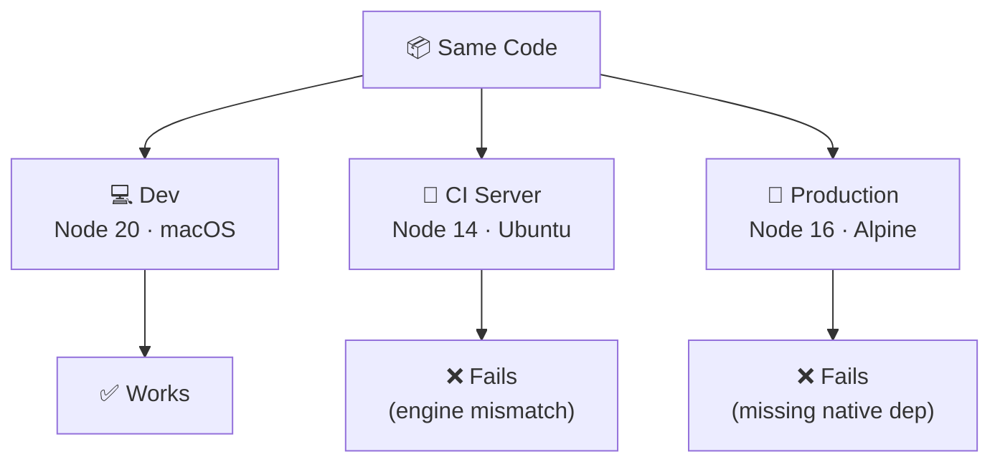
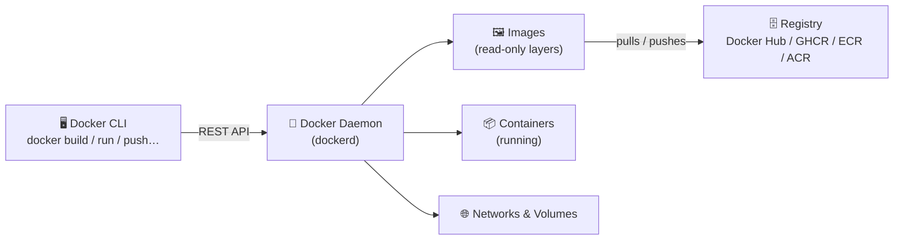

# 🐳 Docker & Containerization

### From a single container to a production cluster

<div class="pt-12 text-gray-400">
  Press <kbd>Space</kbd> to advance
</div>

---
layout: default
---

# Agenda

<div class="grid grid-cols-2 gap-8 mt-4">
<div>

**Part 1 — Docker**
1. The "It Works on My Machine" Problem
2. Containers vs. Virtual Machines
3. The Container Ecosystem
4. Docker Architecture & Images
5. Dockerfiles & Best Practices
6. Core CLI, Networking & Volumes

</div>
<div>

**Part 2 — Orchestration**

7. Docker Compose
8. Why Kubernetes? & K8s Architecture
9. K8s Core Concepts
10. LIVE DEMO — Deploy to Cluster
11. Useful Tools & Resources
12. Q&A

</div>
</div>

---
layout: default
---

# The "It Works on My Machine" Problem

<div class="grid grid-cols-2 gap-x-10 mt-3 items-center">
<div class="text-sm">

**Same code, different environments → unexpected failures**

- Apps are implicitly coupled to the OS, libraries, and runtime they were built against
- Debugging environment-only bugs wastes engineering time and blocks releases
- "Snowflake" servers accumulate hand-crafted state nobody dares change
- **Containers** package the app *and* its entire runtime → runs identically everywhere

</div>
<div>



</div>
</div>

<!--
Startup: When I joined, we had code deployed directly on a server. We needed to scale for some demos (2 machines, which required setting up the code and the machine. The two machines ended up diverting in state (Different libraries versions (especially nvidia, opencv))
-->

---
layout: default
---

# VMs vs Containers

<div class="grid grid-cols-2 gap-x-10 gap-y-1 mt-6 items-start">
<div>

<pre style="font-size:0.6rem;line-height:1.3;padding:0.4rem 0.6rem;background:#f3f4f6;border-radius:4px;">
┌──────────────┐ ┌──────────────┐
│    App A     │ │    App B     │
├──────────────┤ ├──────────────┤
│  Libraries   │ │  Libraries   │
├──────────────┤ ├──────────────┤
│ GuestOS+Kern │ │ GuestOS+Kern │
│ (Ubuntu ~1GB)│ │ (Debian ~1GB)│
├──────────────┴─┴──────────────┤
│         Hypervisor            │
├───────────────────────────────┤
│       Host OS + Hardware      │
└───────────────────────────────┘
</pre>

</div>
<div class="text-sm">

**🖥️ Virtual Machines**

- Each VM carries a **full Guest OS + kernel** (~1 GB each)
- OS is **duplicated** for every workload → heavy disk & RAM
- Boot time: **minutes**
- Use when you need a different kernel or strict tenant isolation

</div>
<div>

<pre style="font-size:0.6rem;line-height:1.3;padding:0.4rem 0.6rem;background:#f3f4f6;border-radius:4px;">
┌──────────────┐ ┌──────────────┐
│    App A     │ │    App B     │
├──────────────┤ ├──────────────┤
│  Libraries   │ │  Libraries   │
│(Node 18 ~50MB│ │(Python ~30MB)│
├──────────────┴─┴──────────────┤
│  Container Runtime (shared)   │
├───────────────────────────────┤
│  Host OS Kernel (shared)      │
├───────────────────────────────┤
│          Hardware             │
└───────────────────────────────┘
</pre>

</div>
<div class="text-sm">

**📦 Containers**

- Only **app + its direct dependencies** — no OS duplication
- All containers share **one host kernel** → MBs instead of GBs
- Boot time: **seconds**
- Ideal for microservices, CI/CD, and standard workloads

</div>
</div>

<style scoped>
h1 { margin-bottom: 0; }
</style>

---
layout: default
---

# Linux Namespaces & cgroups

Containers are **Linux kernel primitives** — namespaces + cgroups packaged with a developer-friendly tool.

<div class="grid grid-cols-2 gap-x-10 mt-3">
<div class="text-sm">

**Namespaces** give each container an isolated view:

| Namespace | Isolates |
|-----------|----------|
| `pid` | Process IDs |
| `net` | Network interfaces & routing |
| `mnt` | Filesystem mounts |
| `uts` | Hostname |
| `ipc` | Inter-process communication |
| `user` | User & group IDs |

</div>
<div class="text-sm">

**cgroups** enforce per-container resource limits:

```bash
docker run --cpus="0.5" --memory="256m" nginx
```

```
Host kernel
├─ Container A
│   namespace: own PID 1, own IP, own fs
│   cgroup: max 256 MB RAM, 0.5 CPU
│
└─ Container B
    namespace: own PID 1, own IP, own fs
    cgroup: max 512 MB RAM, 1 CPU
```

> **Namespaces = isolation · cgroups = resource control**

</div>
</div>

---

# Open Standards & the Container Ecosystem

Container tech could have stayed proprietary — instead, the industry converged on open standards.

<div class="grid grid-cols-2 gap-x-10 mt-2">
<div class="text-sm">

**Timeline**

| Year | Event |
|------|-------|
| 2013 | Docker launches — proprietary engine |
| 2015 | **OCI** founded (Docker + CoreOS + others) |
| 2016 | `runc` donated to OCI — runtime spec born |
| 2017 | Docker engine open-sourced as **Moby** (Apache 2.0) |
| 2017 | `containerd` donated to **CNCF** |
| 2022 | Docker removed as direct K8s runtime (v1.24) |

</div>
<div class="text-sm">

**What this means today**

- **OCI image spec**: `docker build` produces a portable image — runs on *any* compliant runtime
- **OCI runtime spec**: defines what a runtime must do — `runc` is the reference implementation
- **CNCF governance**: containerd, Kubernetes, and 100+ projects are vendor-neutral
- **No lock-in**: swap Docker for Podman or containerd without changing your images or workflows

> Build once, run anywhere — for real this time.

</div>
</div>

<!--
OCI: OPen Container Ini
-->

---

# The Container Runtime Interface (CRI)

Kubernetes never calls Docker directly — it uses the **CRI**, an open gRPC interface.

<div class="grid grid-cols-2 gap-x-10 mt-6 items-start">
<div>

<pre style="font-size:0.65rem;line-height:1.4;padding:0.5rem 0.75rem;background:#f3f4f6;border-radius:4px;">
kubelet (worker node)
    │  gRPC / CRI
    ▼
┌──────────────────────────────────────┐
│  Container Runtime (implements CRI)  │
│  containerd  ·  CRI-O  ·  cri-docker │
└──────────────────────────────────────┘
    │  OCI Runtime Spec
    ▼
  runc  (creates the actual container process)
</pre>

</div>
<div class="text-sm">

- **OCI** standardises image format and runtime spec — `docker build` produces OCI images that run on *any* CRI runtime
- Docker was removed as a direct K8s dependency in **v1.24** — `containerd` handles pods in EKS, GKE, AKS by default
- Your Docker-built images still run unchanged — they are OCI-compliant

</div>
</div>

---

# Docker & Runtime Alternatives

| Runtime | Architecture | Key differentiator |
|---------|-------------|-------------------|
| **Docker Desktop** | Daemon (`dockerd` → `containerd`) | Best DX & CLI — **not free for commercial use** (>250 employees or >$10M revenue) |
| **Podman Desktop** | Daemonless, rootless | Free drop-in replacement; no root daemon; main reason teams are migrating |
| **containerd** | Standalone daemon | Used inside Docker; default in EKS, GKE, AKS |
| **CRI-O** | Minimal CRI-only runtime | Designed exclusively for Kubernetes |

> ⚠️ **Docker Desktop** requires a paid subscription for commercial use — this is the primary driver behind the shift to Podman and other alternatives.

<div class="mt-3">

> **For this session**: we use Docker for its developer experience. All images and concepts transfer directly to any OCI-compliant runtime.

</div>

<!--
Docker desktop on Windows and Mac require a commercial license to use
But it is not needed to use Docker!
On windows, you can run docker engine through WSL
On MacOs, you have to run it through a Linux VM, or use Podman. Apple is working on an implementation called container https://github.com/apple/container
-->

---

# Docker Architecture



---
layout: default
---

# Docker Images

An image is a **read-only, layered filesystem** built from a `Dockerfile`.

<div class="grid grid-cols-2 gap-x-10 mt-4 items-start">
<div class="text-sm">

- Each instruction creates an immutable, cacheable layer — **shared** between images
- **Image tags**: `image:tag` — e.g., `nginx:1.27-alpine`, `lunchdemo-api:1.0`
- `:latest` is the implicit default — **anti-pattern in production**; use semantic versions or Git SHAs
- `docker tag` creates an alias for pushing to a registry

</div>
<div>

<pre style="font-size:0.6rem;line-height:1.4;padding:0.4rem 0.6rem;background:#f3f4f6;border-radius:4px;">lunchdemo-api:1.0
├── Layer 4  COPY app.py .              ← your code
├── Layer 3  COPY --from=builder /venv  ← installed venv
├── Layer 2  COPY requirements.txt .    ← dep list (cached)
└── Layer 1  FROM python:3.12-slim      ← base OS
</pre>

<pre style="font-size:0.6rem;line-height:1.4;padding:0.4rem 0.6rem;background:#1e1e2e;color:#cdd6f4;border-radius:4px;"># List local images
docker images lunchdemo-api

# Tag for a registry
docker tag lunchdemo-api:1.0 \
  ghcr.io/myorg/lunchdemo-api:1.0

# Push to registry
docker push ghcr.io/myorg/lunchdemo-api:1.0

# Inspect layer history
docker history lunchdemo-api:1.0
</pre>

</div>
</div>

---

# The Dockerfile — `demo/api/Dockerfile`

```dockerfile
# ── Stage 1: install dependencies ─────────────────────
FROM python:3.12-slim AS builder      # named stage — not in final image
WORKDIR /build
COPY requirements.txt .               # copy deps first → caches this layer
RUN python -m venv /venv && \
    /venv/bin/pip install --no-cache-dir -r requirements.txt

# ── Stage 2: lean runtime image ───────────────────────
FROM python:3.12-slim                 # fresh image; no build tools included
WORKDIR /app
COPY --from=builder /venv /venv       # only the installed venv crosses stages
COPY app.py .
RUN useradd -r -u 1001 appuser        # non-root user — smaller blast radius
USER appuser
ENV PATH="/venv/bin:$PATH"
EXPOSE 8000
CMD ["gunicorn", "--bind", "0.0.0.0:8000", "--workers", "2", "app:app"]
```

---

# Dockerfile Best Practices

<div class="grid grid-cols-2 gap-6">
<div>

✅ **Do**
- Use **multi-stage builds** to keep images small
- Pin base image versions (`node:20.11-alpine`)
- Run as a **non-root user**
- Use `.dockerignore` to exclude `node_modules`, `.git`
- Leverage **build cache** — copy dependency files before the rest of source
- Use `--mount=type=cache` for package managers
- Set `HEALTHCHECK` for orchestrators

</div>
<div>

❌ **Don't**
- `RUN apt-get update` without `apt-get install` in the same layer
- Store secrets in `ENV` or `COPY` them into layers
- Run as `root` in production
- Use `latest` tag for base images in production
- Install unnecessary tools (`curl`, `vim`) in runtime stage
- Chain many `RUN` layers without purpose

</div>
</div>

<!--
Build cache tip: COPY requirements.txt . (or package.json / go.mod) before COPY . .
Docker caches each layer; the install step only re-runs when the dependency file changes,
not on every code edit — keeping rebuilds fast.

multi-stage builds is the secret to keeping images small. Choose a small base image (like alpine) and only put what you need

You do not want to chain RUN, and instead run all your commands as one. You dont want to create a new layer for each command
-->

---

# .dockerignore

**Like `.gitignore` for Docker** — prevents `COPY .` from including unwanted files in the build context.

<div class="grid grid-cols-2 gap-6 items-center">
<div>

```bash
# .dockerignore
__pycache__/
*.pyc
.venv/
venv/
.env
.env.*
*.log
.git/
.pytest_cache/
```

</div>
<div>

**Why it matters:**

- 🔒 **Security** — `.env` secrets won't leak into image layers
- ⚡ **Performance** — smaller build context = faster daemon transfer
- ✅ **Correctness** — `COPY .` won't overwrite container files with local artefacts

> Start with `.git/`, `.env*`, and `__pycache__/` — add more as needed.

</div>
</div>

---

# Core CLI Commands

```bash
# ── Build ──────────────────────────────────────────────────
docker build -t lunchdemo-api:1.0 ./api      # build from Dockerfile
# Run again immediately → all steps CACHED (no reinstall)

# ── Run ────────────────────────────────────────────────────
docker run -d \
  --name api \
  --network lunchdemo-net \
  -e DATABASE_URL=postgresql://postgres:secret@db:5432/lunchdemo \
  -p 8000:8000 \
  lunchdemo-api:1.0

# ── Inspect & Debug ────────────────────────────────────────
docker ps                              # running containers
docker logs -f api                     # stream logs
docker exec -it api sh                 # shell into running container

# ── Lifecycle ──────────────────────────────────────────────
docker stop api && docker rm api
docker system prune -af               # remove stopped containers, images, networks
```

---

# Networking

Docker provides **built-in network drivers**:

<div class="grid grid-cols-2 gap-x-10 mt-3 items-center">
<div>

| Driver | Use case |
|--------|----------|
| `bridge` | Default; containers on same host |
| `host` | Share host network stack |
| `none` | Fully isolated |
| `overlay` | Multi-host (Swarm/K8s) |

<pre style="font-size:0.6rem;line-height:1.4;padding:0.4rem 0.6rem;background:#f3f4f6;border-radius:4px;margin-top:0.5rem;">lunchdemo-net (bridge)
┌───────────────────────────────┐
│ db  (postgres:16-alpine)      │ → db:5432
│ api (lunchdemo-api:1.0)       │ → api:8000 → localhost:8000
└───────────────────────────────┘</pre>

</div>
<div>

<pre style="font-size:0.6rem;line-height:1.5;padding:0.4rem 0.6rem;background:#1e1e2e;color:#cdd6f4;border-radius:4px;"># Create the lunchdemo bridge network
docker network create lunchdemo-net

# Start the database
docker run -d --name db \
  --network lunchdemo-net \
  postgres:16-alpine

# Start the API — "db" resolves by container name!
docker run -d --name api \
  --network lunchdemo-net \
  -e DATABASE_URL=postgresql://postgres:secret@db:5432/lunchdemo \
  -p 8000:8000 lunchdemo-api:1.0

# Verify container-name DNS works
curl http://localhost:8000/api/health   # → {"status": "ok"}
docker network inspect lunchdemo-net</pre>

</div>
</div>

<!--
Bridge creates a new private network on the host. ports need to be forwarded to access them from the host

host driver sits on the same entwork as the host. ports don<t need to be opened>
-->

---

# Volumes

Containers are **ephemeral** — filesystem changes are lost when a container is removed.

**Volumes** provide persistent, managed storage:

<div class="grid grid-cols-2 gap-x-10 mt-3 items-center">
<div>

| Type | Use case |
|------|----------|
| Named volume | Managed by Docker; best for databases |
| Bind mount | Map host path; best for dev hot-reload |
| tmpfs mount | In-memory; ephemeral sensitive data |

</div>
<div>

<pre style="font-size:0.6rem;line-height:1.5;padding:0.4rem 0.6rem;background:#1e1e2e;color:#cdd6f4;border-radius:4px;"># Named volume for lunchdemo PostgreSQL
docker volume create lunchdemo-pgdata

docker run -d --name db \
  --network lunchdemo-net \
  -v lunchdemo-pgdata:/var/lib/postgresql/data \
  -e POSTGRES_PASSWORD=secret \
  postgres:16-alpine

# Data persists even after the container is removed:
docker rm db
docker volume ls            # lunchdemo-pgdata still listed!

# Bind mount for dev hot-reload
docker run -d \
  -v $(pwd)/api:/app \
  lunchdemo-api:1.0

docker volume inspect lunchdemo-pgdata
docker volume prune</pre>

</div>
</div>

---
layout: cover
background: https://cover.sli.dev
---

# Part 2: Orchestration

### Docker Compose → Kubernetes

---

# Why Docker Compose?

<div class="grid grid-cols-2 gap-4 mt-4 text-sm">
<div>

**Without Compose** — start `lunchdemo` manually:

```bash
docker network create lunchdemo-net
docker volume create lunchdemo-pgdata
docker run -d --name db \
  --network lunchdemo-net \
  -v lunchdemo-pgdata:/var/lib/postgresql/data \
  -e POSTGRES_PASSWORD=secret \
  postgres:16-alpine
docker run -d --name api \
  --network lunchdemo-net \
  -e DATABASE_URL=postgresql://...@db/lunchdemo \
  -p 8000:8000 lunchdemo-api:1.0
docker run -d --name nginx \
  --network lunchdemo-net \
  -p 80:80 lunchdemo-nginx:1.0
```

</div>
<div>

**With Compose** — one command:

```bash
docker compose up -d
```

```
✓ Network  lunchdemo_backend    Created
✓ Volume   lunchdemo_pgdata     Created
✓ Container lunchdemo-db-1      Started
✓ Container lunchdemo-api-1     Started
✓ Container lunchdemo-nginx-1   Started
```

```bash
docker compose down        # stop and clean up
docker compose logs -f api # stream service logs
```

</div>
</div>

<!--
We have to create the volume, the netowrks, then we have to start the services, and we have to make sure to start them in the right order
if we start api before database, api will error because it won't be able to connect to the database
-->

---

# Docker Compose YAML

<span class="text-gray-400 text-sm font-mono">`demo/docker-compose.yml`</span>

<pre style="font-size:0.55rem;line-height:1.25;padding:0.4rem 0.75rem;background:#f3f4f6;border-radius:4px;margin-top:0.25rem;">services:
  nginx:
    build: ./nginx            # builds from demo/nginx/Dockerfile
    ports:
      - "80:80"
    depends_on:
      api:
        condition: service_healthy
    networks: [backend]

  api:
    build: ./api              # builds from demo/api/Dockerfile
    environment:
      DATABASE_URL: postgresql://postgres:secret@db:5432/lunchdemo
    depends_on:
      db:
        condition: service_healthy   # waits for pg_isready to pass
    healthcheck:
      test: ["CMD", "python", "-c",
        "import urllib.request; urllib.request.urlopen('http://localhost:8000/api/health')"]
      interval: 5s
      retries: 5
    networks: [backend]

  db:
    image: postgres:16-alpine
    environment:
      POSTGRES_PASSWORD: secret
      POSTGRES_DB: lunchdemo
    volumes:
      - pgdata:/var/lib/postgresql/data   # named volume → persists
    networks: [backend]

volumes:
  pgdata:
networks:
  backend:
</pre>

---

# .env — Keep Secrets Out of YAML

Compose reads `.env` in the project root and substitutes `${VAR}` references automatically.

<div class="grid grid-cols-2 gap-6">
<div>

<div class="border-l-2 border-gray-300 pl-3 mb-3">

**`.env`** *(git-ignored)*

```bash
POSTGRES_PASSWORD=mysecretpassword
POSTGRES_DB=lunchdemo
```

</div>
<div class="border-l-2 border-gray-300 pl-3">

**`docker-compose.yml`**

```yaml
  db:
    environment:
      POSTGRES_PASSWORD: ${POSTGRES_PASSWORD}
      POSTGRES_DB: ${POSTGRES_DB}
```

</div>

</div>
<div>

- Add `.env` to `.gitignore` — never commit real credentials
- Commit `.env.example` with placeholder values for teammates
- `docker compose config` verifies variable substitution
- `docker compose --env-file .env.prod up` for per-environment overrides

</div>
</div>

---

# Compose Commands Cheat-Sheet

```bash
# ── Lifecycle ──────────────────────────────────────────────
docker compose up -d              # start all services (detached)
docker compose up --build         # rebuild images before starting
docker compose down               # stop + remove containers & networks
docker compose down -v            # also remove named volumes

# ── Dev inner loop ─────────────────────────────────────────
# Rebuild one service without restarting the whole stack:
docker compose build api && \
  docker compose up -d --no-deps api

# ── Inspection ─────────────────────────────────────────────
docker compose ps                 # list services and health status
docker compose logs -f            # all service logs
docker compose logs -f api        # single service

# ── One-off ────────────────────────────────────────────────
docker compose exec api sh        # shell into running service
docker compose config             # print resolved config (with .env subs)
```

---

# Why Kubernetes?

Compose is great for a **single host**. Production needs more:

<div class="text-sm mt-3">

| Challenge | Kubernetes answer |
|-----------|-------------------|
| Container dies | Automatic **self-healing** (restarts) |
| Traffic spike | Horizontal **auto-scaling** (HPA) |
| Zero-downtime deploy | **Rolling updates** |
| Multiple nodes | **Cluster scheduling** |
| Service discovery | Built-in **DNS + load balancing** |
| Secret management | Native **Secrets** API |
| Storage | **PersistentVolumes** with dynamic provisioning |

</div>

> K8s is essentially **Docker Compose at datacenter scale**, with built-in resilience.

---

# Kubernetes Architecture

<div class="grid grid-cols-2 gap-x-10 mt-4">
<div class="text-sm">

**⚙️ Control Plane** (master node)

| Component | Role |
|-----------|------|
| **API Server** | All traffic goes through here; `kubectl` target |
| **etcd** | Distributed key-value store — single source of truth for cluster state |
| **Scheduler** | Assigns new pods to nodes based on resources |
| **Controller Manager** | Runs reconciliation loops (self-healing, scaling) |

</div>
<div class="text-sm">

**🖥️ Worker Nodes** (data plane)

| Component | Role |
|-----------|------|
| **kubelet** | Agent that runs pods and reports status to the API Server |
| **kube-proxy** | Manages network rules for Service routing |
| **Container runtime** | Runs the actual containers (`containerd`, CRI-O) |

> Every object (pod, service, deployment) is stored in **etcd** and reconciled continuously by the Control Plane.

</div>
</div>

---

# Namespaces

A **Namespace** is a virtual cluster within your cluster — used to isolate resources by team, environment, or application.

```bash
# All lunchdemo manifests target the lunchdemo namespace
kubectl get pods -n lunchdemo
kubectl get services -n lunchdemo

# Create the namespace
kubectl create namespace lunchdemo

# Set as default for your kubectl session
kubectl config set-context --current --namespace=lunchdemo
```

- `default` is used when no `-n` flag is given — avoid it for real workloads
- Common patterns: namespace per app (`lunchdemo`) or per environment (`dev`, `staging`, `prod`)
- Resources in different namespaces are isolated by default

---

# The Pod — Smallest Unit

A **Pod** wraps one or more containers that share:
- Network namespace (same IP, ports)
- Storage volumes
- Lifecycle — pods are **ephemeral**; when a pod dies it is replaced, not repaired

<pre style="font-size:0.6rem;line-height:1.35;padding:0.5rem 0.75rem;background:#f3f4f6;border-radius:4px;">apiVersion: v1
kind: Pod
metadata:
  name: api-pod
  namespace: lunchdemo
  labels:
    app: api
spec:
  containers:
    - name: api
      image: lunchdemo-api:1.0
      ports:
        - containerPort: 8000
      env:
        - name: DATABASE_URL
          valueFrom:
            secretKeyRef:
              name: lunchdemo-secret
              key: DATABASE_URL
</pre>

> In practice, **you never create Pods directly** — you create a Deployment that manages them.

---

# Deployments

A **Deployment** declares desired state; Kubernetes reconciles actual → desired continuously.

<pre style="font-size:0.6rem;line-height:1.35;padding:0.5rem 0.75rem;background:#f3f4f6;border-radius:4px;">apiVersion: apps/v1
kind: Deployment
metadata:
  name: api
  namespace: lunchdemo
spec:
  replicas: 2                       # desired pod count; self-heals on failure
  selector:
    matchLabels:
      app: api
  strategy:
    type: RollingUpdate
    rollingUpdate:
      maxSurge: 1
      maxUnavailable: 0             # zero downtime during rollout
  template:
    metadata:
      labels:
        app: api
    spec:
      containers:
        - name: api
          image: lunchdemo-api:1.0
          ports:
            - containerPort: 8000
</pre>

<pre style="font-size:0.6rem;line-height:1.35;padding:0.5rem 0.75rem;background:#1e1e2e;color:#cdd6f4;border-radius:4px;">kubectl rollout status deploy/api -n lunchdemo   # watch rollout progress
kubectl rollout undo deploy/api -n lunchdemo     # roll back if needed
</pre>

---

# Services

Pods are ephemeral and get new IPs. A **Service** provides a **stable DNS name + load-balanced IP** in front of a set of Pods.

<div class="grid grid-cols-2 gap-x-10 mt-4 items-center">
<div>

```yaml
apiVersion: v1
kind: Service
metadata:
  name: api
spec:
  selector:
    app: api          # matches Deployment's pod labels
  ports:
    - port: 80
      targetPort: 3000
  type: ClusterIP     # internal only
```

</div>
<div>

| Service Type | Reachable from | Use case |
|---|---|---|
| `ClusterIP` | Inside cluster only | Inter-service communication |
| `NodePort` | Any node's IP | Dev / simple external access |
| `LoadBalancer` | Internet (cloud LB) | Production external traffic |
| `Ingress` | Internet via HTTP rules | Virtual hosting, TLS, path routing |

</div>
</div>

---

# ConfigMaps & Secrets

<div class="grid grid-cols-2 gap-x-10 mt-4 items-start">
<div>

**ConfigMap** — non-sensitive config

```yaml
apiVersion: v1
kind: ConfigMap
metadata:
  name: lunchdemo-config
  namespace: lunchdemo
data:
  LOG_LEVEL: "info"
  DB_NAME: "lunchdemo"
```

Use in a Pod:

```yaml
envFrom:
  - configMapRef:
      name: lunchdemo-config
```

</div>
<div>

**Secret** — sensitive values (base64-encoded at rest)

<pre style="font-size:0.62rem;line-height:1.4;padding:0.4rem 0.6rem;background:#f3f4f6;border-radius:4px;">apiVersion: v1
kind: Secret
metadata:
  name: lunchdemo-secret
  namespace: lunchdemo
type: Opaque
stringData:             # K8s encodes automatically
  DATABASE_URL: "postgresql://postgres:secret@db:5432/lunchdemo"
</pre>

Use in a Pod:

```yaml
env:
  - name: DATABASE_URL
    valueFrom:
      secretKeyRef:
        name: lunchdemo-secret
        key: DATABASE_URL
```

> In production: use **Sealed Secrets**, **External Secrets Operator**, or a vault.

</div>
</div>

---

# Persistent Volumes

Stateful apps (like PostgreSQL) need storage that **survives pod restarts**.

**PersistentVolumeClaim (PVC)** — a request for durable storage from the cluster

<div class="grid grid-cols-2 gap-x-10 mt-3 items-start">
<div>

PVC definition:

```yaml
apiVersion: v1
kind: PersistentVolumeClaim
metadata:
  name: lunchdemo-pgdata
  namespace: lunchdemo
spec:
  storageClassName: standard
  accessModes:
    - ReadWriteOnce
  resources:
    requests:
      storage: 1Gi
```

</div>
<div>

Mount in a StatefulSet:

```yaml
spec:
  containers:
    - name: db
      image: postgres:16-alpine
      volumeMounts:
        - mountPath: /var/lib/postgresql/data
          name: pgdata
  volumes:
    - name: pgdata
      persistentVolumeClaim:
        claimName: lunchdemo-pgdata
```

> **StatefulSet** = like a Deployment but each pod gets a stable identity and its own PVC — use it for databases. The demo uses one for PostgreSQL.

</div>
</div>

---

# LIVE DEMO — Deploy `lunchdemo` to Kubernetes

```bash
# 1. Point Docker at minikube's internal daemon (no registry push needed)
eval $(minikube docker-env)

# 2. Build the API image inside minikube
docker build -t lunchdemo-api:1.0 ./api

# 3. Apply all manifests declaratively
kubectl apply -f demo/k8s/
# namespace/lunchdemo created
# configmap/lunchdemo-config created  secret/lunchdemo-secret created
# deployment.apps/api created         service/api created
# deployment.apps/nginx created       service/nginx created
# statefulset.apps/db created         service/db created

# 4. Watch pods reach Running state
kubectl get pods -n lunchdemo --watch

# 5. Get the app URL and open it in a browser
minikube service nginx -n lunchdemo --url
```

```
kubectl apply → API Server → etcd ← Scheduler → kubelet → runc → 🟢 Running pod
```

---

# Compose → Kubernetes Mapping

<div class="grid grid-cols-2 gap-x-10 mt-4 items-center">
<div class="text-sm">

| Docker Compose | Kubernetes |
|---|---|
| `service` | `Deployment` + `Service` |
| `ports` | `Service` (NodePort / LB) |
| `environment` | `ConfigMap` / `Secret` |
| `volumes` (named) | `PersistentVolumeClaim` |
| `networks` | Namespace + `NetworkPolicy` |
| `depends_on` | `InitContainers` / readiness probes |
| `replicas` | `spec.replicas` on Deployment |
| `.env` file | `ConfigMap` / `Secret` |

</div>
<div>

```bash
# kompose converts Compose → K8s YAML
# (great starting point, then tune manually)

brew install kompose

kompose convert -f docker-compose.yml \
  --out ./k8s/

# Generates:
#   k8s/api-deployment.yaml
#   k8s/api-service.yaml
#   k8s/db-deployment.yaml
#   k8s/db-service.yaml
#   k8s/pgdata-persistentvolumeclaim.yaml
```

</div>
</div>

---

# Summary

<div class="grid grid-cols-3 gap-4 text-sm mt-4">

<div class="border border-blue-800 rounded p-3">

### 🐳 Docker

- Packages app + runtime into an **image**
- Runs isolated **containers** from that image
- Dockerfile = reproducible build recipe
- `.dockerignore` + multi-stage = small, secure images

</div>

<div class="border border-green-800 rounded p-3">

### 🔧 Docker Compose

- Declarative multi-container stacks
- Single YAML file, single command
- Health checks + `depends_on` for startup ordering
- Named volumes for persistence
- Ideal for **local dev** and **CI**

</div>

<div class="border border-purple-800 rounded p-3">

### ☸️ Kubernetes

- Orchestrates containers across a **cluster**
- Self-healing, auto-scaling, rolling updates
- Objects: Pod → Deployment → Service
- ConfigMap / Secret for config injection
- PVC for persistent storage

</div>

</div>

---

# Useful Tools & Ecosystem

<div class="grid grid-cols-3 gap-3 text-sm mt-4">

<div class="border border-blue-400 rounded p-3">

**[Lens](https://k8slens.dev/)**
Kubernetes IDE — visual cluster management, live pod logs, and resource editing from a GUI

</div>

<div class="border border-blue-400 rounded p-3">

**[k9s](https://k9scli.io/)**
Terminal-based K8s UI — real-time pod and service monitoring without leaving the shell

</div>

<div class="border border-green-400 rounded p-3">

**[Portainer](https://www.portainer.io/)**
Web UI for Docker and K8s across multiple hosts — great for homelabs and small VM fleets

</div>

<div class="border border-purple-400 rounded p-3">

**[kind](https://kind.sigs.k8s.io/)**
Run local K8s clusters using Docker container nodes — ideal for CI pipelines

</div>

<div class="border border-purple-400 rounded p-3">

**[k3d](https://k3d.io/)**
Run k3s (lightweight K8s) in Docker — fastest local cluster spin-up option

</div>

<div class="border border-gray-400 rounded p-3">

**[Play with Docker](https://labs.play-with-docker.com/)**
Free browser-based Docker playground — zero install, great for quick experiments

</div>

</div>

<div class="mt-4 text-sm">

📚 **Official docs**: [docs.docker.com](https://docs.docker.com) · [kubernetes.io/docs](https://kubernetes.io/docs/home/) · [CNCF Landscape](https://landscape.cncf.io)

</div>

---
layout: center
class: text-center
---

# Thank You! 🐳

### Questions?

<div class="text-gray-400 mt-4 text-sm">
  Built with <a href="https://sli.dev" class="text-blue-400">Slidev</a>
</div>
